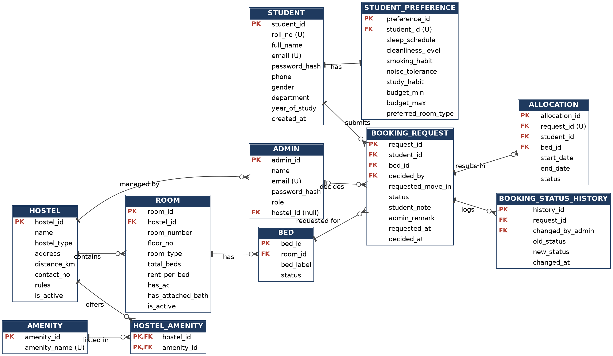

# Student Accommodation & Roommate Finder for Hostel

*Mini Project Case Study \| Subject: Relational Database Management System (RDBMS)*

## 1. Cover Page

**Project Title:** Student Accommodation & Roommate Finder for Hostel

**Subject:** Relational Database Management System (RDBMS)

**Document:** Mini Project Case Study (Experiment 7)

| Sr. No. | Student Name            | Roll No.   |
|---------|-------------------------|------------|
| 1       | Mhatre Pratham Vijay    | 2025800079 |
| 2       | Mhatre Ashmit Ashok     | 2025800080 |
| 3       | Prathmesh Mahesh Mohite | 2025800081 |

**Branch:** CSE \| **Division:** B1 \| **Academic Year:** \[2026-2027\]

**College:** Sardar Patel Institution of Technology

**Subject Faculty:** Prof. Aparna Hable

## 2. Abstract

The Student Accommodation & Roommate Finder for Hostel is a database-driven system that helps college students discover hostel accommodation, compare rooms by budget and facilities, find lifestyle-compatible roommates, and track booking requests in one place. Hostel administrators use the same system to maintain hostel listings, rooms, beds and availability, and to approve or reject booking requests.

The case study identifies the requirements, entities, relationships and dependencies of the system, and shows how a normalized MySQL relational database supports registration, search, filtering, compatibility matching, booking and history. The system is built with HTML, CSS, JavaScript and React for the user interface, Node.js as the server-side layer between the interface and the database, and MySQL for persistent storage. Because browser-side code cannot securely access MySQL directly, the document also explains why Node.js is used as the intermediate layer (Section 14).

## 3. Introduction and Background

- Students who move to a new city for higher education usually need hostel accommodation, and demand for beds is often higher than supply.

- Hostel details (rent, room types, vacancies, rules, facilities) are generally scattered across notice boards, brochures, messaging groups and word of mouth.

- Sharing a room with an incompatible person affects sleep, studies and mental well-being, yet roommates are usually assigned by chance.

- Administrators manage room allocation on paper registers or spreadsheets, which are error-prone and hard to search.

- A relational database is well suited to this domain because the data is structured and strongly interrelated (students, hostels, rooms, beds, requests), and it needs integrity rules, concurrent access and reliable history.

- The project demonstrates core RDBMS concepts: entity identification, ER modelling, relational schema, keys, constraints, normalization, SQL and transactions.

## 4. Problem Statement

### 4.1 Difficulties students face when searching for hostel accommodation

- No single place lists all hostels with their rent, room types, facilities and distance from campus.

- Information is often outdated, incomplete or inconsistent between sources.

- Students cannot easily filter by budget, gender-specific hostels, room type, AC, attached bathroom or mess facility.

- Students must visit or call each hostel individually, wasting time and money, especially when relocating from another city.

- Rules, fees and deposits are not clearly visible before applying.

### 4.2 Problems in finding compatible roommates

- Roommates are assigned randomly or by first-come order, without considering habits.

- Conflicts arise from differences in sleep schedule, cleanliness, smoking, noise tolerance and study habits.

- Students have no structured way to state their preferences, and no way to see how well they match a prospective roommate.

- Informal searches through social groups are unreliable and raise privacy concerns.

### 4.3 Lack of centralized room availability and booking information

- Vacancies are tracked manually, so the same bed can be promised to two students (double booking).

- Students do not know whether a bed is available at the time they apply.

- After applying, students cannot see whether the request is pending, approved or rejected, so they keep following up with the office.

- Administrators cannot quickly see occupancy, pending requests or past allocations.

## 5. Objectives of the Project

1.  Provide a centralized, searchable database of hostels, rooms and beds with current availability.

2.  Allow students to register, maintain a profile and record lifestyle and budget preferences.

3.  Enable filtering of accommodation by budget, hostel type, room type, amenities and location.

4.  Calculate a roommate compatibility score from stored preferences.

5.  Allow students to submit booking requests and track their status.

6.  Allow administrators to manage hostels, rooms, beds and booking decisions.

7.  Prevent double booking and invalid allocations through constraints and transactions.

8.  Preserve a complete booking and status history.

9.  Design a normalized (up to 3NF) MySQL database with proper primary keys, foreign keys and constraints.

10. Demonstrate the full RDBMS workflow: requirements, ER model, relational schema, normalization, table creation and sample data.

## 6. Scope of the System

### 6.1 Features included in the initial version

- Student registration, login and profile management.

- Roommate and budget preference storage.

- Hostel listing, room and bed listing, availability display.

- Search and filtering of accommodation.

- Roommate compatibility score (computed from stored preferences).

- Booking request submission, cancellation, and status tracking.

- Administrator approval or rejection of requests with remarks.

- Hostel, room, bed and amenity management by administrators.

- Booking history for students and administrators.

- Responsive user interface built with HTML, CSS, JavaScript and React.

- Node.js server-side layer that connects the interface to the MySQL database.

### 6.2 Features explicitly excluded from the initial version

- Online payment, fee collection and refunds (rent is shown for information only).

- In-app chat or messaging between students.

- Mobile application, push notifications, SMS and email gateways.

- Automatic AI or machine-learning roommate recommendation (only rule-based scoring is used).

- Room swapping, mess menu management, visitor logs and complaint management.

- Document upload or identity verification (KYC).

- Multi-college or multi-city support beyond a single college deployment.

## 7. Existing System and Its Limitations

**Existing system:** Accommodation is currently handled through notice boards, printed brochures, hostel office registers or spreadsheets, phone calls, messaging groups and local brokers.

**Limitations:**

- Data is scattered, duplicated and not searchable.

- No real-time visibility of vacancies; double booking is possible.

- No filtering by budget or preferences.

- No roommate compatibility consideration.

- No transparent request tracking; students depend on repeated enquiries.

- Records are stored on paper or in unprotected files, with risk of loss, tampering and inconsistency.

- Reports such as occupancy or booking history require manual effort.

- Weak privacy: personal details are shared openly in public groups.

## 8. Proposed System and Its Advantages

**Proposed system:** A web application with a MySQL database at its core. Students browse and filter rooms, view compatibility information, submit requests and track them. Administrators manage listings and decisions. All data lives in one relational database governed by integrity constraints.

**Advantages:**

- Single source of truth for hostel, room, bed and booking data.

- Real-time bed availability reduces double booking.

- Fast filtering and searching with SQL queries and indexes.

- Objective roommate compatibility scoring.

- Transparent status tracking (Pending, Approved, Rejected, Cancelled).

- Reduced administrative workload and fewer errors.

- Complete audit trail through booking and status history.

- Data integrity enforced by the DBMS, not by manual care.

- Easy to extend with new hostels, room types and amenities.

## 9. Feasibility Study

### 9.1 Technical feasibility

- The required technologies (HTML, CSS, JavaScript, React, Node.js, MySQL) are mature, well documented and widely used.

- The data model (about 11 tables) is moderate in size and fits MySQL 8.x easily, including CHECK constraints, foreign keys, views, stored procedures, triggers and transactions.

- HTML, CSS, JavaScript and React handle the interface and client-side validation; Node.js handles authentication, business logic and database access.

- Limitation: browser code cannot connect directly and securely to MySQL, so Node.js is used as the server-side layer between the React interface and the database (see Section 14). The database can also be built and tested independently through MySQL scripts.

### 9.2 Operational feasibility

- Students and administrators only need a web browser; the interface is simple and form-based.

- The system replaces manual registers and fits the existing hostel allocation process.

- Administrator workload decreases because requests arrive in a structured form.

- Minimal training is required.

### 9.3 Economic feasibility

- MySQL Community Edition, Node.js, React, HTML, CSS and JavaScript are free to use, so there is no software licensing cost.

- Development can be done on existing student laptops.

- Hosting is the only possible running cost; a college server or a local machine is sufficient for a demonstration.

- Benefits: less paperwork, less administrative time, fewer allocation disputes.

## 10. Functional Requirements

**FR1. Student registration and login**

- A student registers with name, college roll number, email, phone, gender, department, year and password.

- Email and roll number must be unique.

- Passwords are stored only as salted hashes, never as plain text.

- Login validates credentials and starts a session; logout ends it.

**FR2. Student profile management**

- Student can view and edit personal details.

- Student can set budget range, preferred room type, and move-in date.

- Email and roll number changes are restricted.

**FR3. Hostel listing and search**

- Display hostels with name, type (boys / girls / co-ed), address, distance from campus, contact, rules and amenities.

- Search by hostel name or area.

- Show only hostels that match the student's gender policy.

**FR4. Room and bed availability management**

- Each hostel contains rooms; each room contains beds.

- Each bed has a status: Available, Booked or Under Maintenance.

- Availability is derived from bed status and updated when a request is approved, cancelled or an allocation ends.

**FR5. Accommodation filtering**

- Filter by rent range, hostel, room type (single / double / triple), floor, AC, attached bathroom, mess facility and other amenities.

- Show only rooms with at least one available bed (option).

- Sort by rent or distance.

**FR6. Roommate preferences and compatibility matching**

- Student records sleep schedule, cleanliness level, smoking habit, noise tolerance and study habit.

- For a selected room, the system shows a compatibility percentage with current occupants (Section 17).

- Only limited, non-sensitive information is shown to other students.

**FR7. Booking request submission**

- Student selects an available bed and submits a request with desired move-in date and optional note.

- System rejects the request if the bed is unavailable, the hostel type does not match gender, or the student already has an active pending request or allocation.

**FR8. Booking approval or rejection**

- Hostel administrator views pending requests for their hostel.

- Administrator approves or rejects with a remark.

- On approval, the bed is marked Booked and an allocation record is created in one transaction.

- Other pending requests for the same bed are automatically rejected as unavailable.

**FR9. Booking status tracking**

- Student sees the current status of each request with date and administrator remark.

- Every status change is logged with time and actor.

- Student may cancel a pending request.

**FR10. Hostel and room management**

- Administrator can add, edit and deactivate hostels, rooms, beds and amenities for their hostel.

- Rooms or beds with active allocations cannot be deleted; they can only be deactivated.

**FR11. Viewing booking history**

- Student sees all past and current requests and allocations.

- Administrator sees history by hostel, room, student or date, and can review occupancy.

## 11. Non-Functional Requirements

- **Usability:** simple navigation, clear labels, helpful validation messages, consistent layout, responsive design for mobile and desktop, basic accessibility (labels, contrast, keyboard navigation).

- **Performance:** common searches should return results in about 2 seconds for typical college-scale data; indexes on frequently filtered columns (rent, hostel, room type, bed status, student, request status).

- **Reliability:** regular database backups; transactions for approvals so partial updates never remain; graceful error messages.

- **Security:** hashed passwords, role-based access, parameterized queries or stored procedures to prevent SQL injection, least-privilege database accounts, input validation on both client and server side, database credentials kept only in server-side Node.js configuration and never in browser code, session timeout.

- **Data integrity:** primary keys, foreign keys, UNIQUE, NOT NULL, CHECK and ENUM-type constraints; triggers or procedures for rules MySQL cannot express declaratively; ACID transactions.

- **Maintainability:** consistent naming, modular schema, documented SQL scripts, normalization to 3NF, ability to add amenities or room types without redesign.

## 12. User Roles and Permissions

### Student

- Register, log in, manage own profile and preferences.

- Browse, search and filter hostels and rooms.

- View compatibility information.

- Submit, view and cancel own booking requests; view own history.

### Hostel administrator

- Log in with an account assigned to a specific hostel.

- Manage rooms, beds, availability and amenities of that hostel only.

- Review, approve or reject booking requests for that hostel.

- View booking history and occupancy of that hostel.

### System administrator (justified, minimal role)

A system administrator is justified because someone must create hostel records and hostel administrator accounts, and maintain master data such as the amenity list and account status; otherwise these would need manual database edits. The role is kept limited: it does not approve bookings. If the faculty prefers a simpler design, this role can be merged into the hostel administrator role.

| Action                            | Student | Hostel Admin | System Admin |
|-----------------------------------|---------|--------------|--------------|
| Register / edit own profile       | Yes     | \-           | \-           |
| Browse and filter hostels         | Yes     | Yes          | Yes          |
| Submit / cancel booking request   | Yes     | \-           | \-           |
| Approve / reject request          | \-      | Own hostel   | \-           |
| Manage rooms and beds             | \-      | Own hostel   | \-           |
| Create hostels and admin accounts | \-      | \-           | Yes          |
| Manage amenity master data        | \-      | \-           | Yes          |
| View booking history              | Own     | Own hostel   | Summary only |

## 13. System Workflow

**Student side**

1.  **Registration:** student fills the registration form; JavaScript checks required fields, email format and password strength; the Node.js layer inserts a row into STUDENT after checking uniqueness.

2.  **Login:** credentials are verified against the stored password hash; a session identifies the student.

3.  **Profile and preferences:** student completes profile and lifestyle preferences (STUDENT_PREFERENCE), and sets budget range.

4.  **Browse hostels:** the system lists hostels matching the student's gender policy, with amenities.

5.  **Filter rooms:** student applies filters (rent, room type, amenities); the system runs a query joining HOSTEL, ROOM, BED and amenities, returning rooms with available beds.

6.  **View compatibility:** for a chosen room, the system compares the student's preferences with those of current occupants and displays a score.

7.  **Submit booking request:** student selects a bed and submits; validations are applied and a row is inserted into BOOKING_REQUEST with status Pending; a first row is added to BOOKING_STATUS_HISTORY.

8.  **Track status:** student views the request list with status, date and remarks; may cancel while Pending.

**Administrator side**

9.  **Manage listings:** administrator adds or updates rooms, beds, rent and amenities.

10. **Review requests:** administrator opens the pending list for the hostel and views request details, with the student's profile and compatibility with current occupants.

11. **Decision:** administrator approves or rejects with a remark.

    - **Approve:** in one transaction, the bed row is locked, bed status becomes Booked, request status becomes Approved, an ALLOCATION row is created, other pending requests for that bed become Rejected, and history rows are written.

    - **Reject:** request status becomes Rejected with a remark; the bed stays Available.

12. **Student sees outcome:** updated status and remark appear in the student's tracking page.

13. **History and occupancy:** all completed requests and allocations remain in history; when a stay ends, the allocation is closed and the bed becomes Available again.

## 14. Technology Stack and System Architecture

**Technology stack:**

- **HTML** for page structure (forms, tables, lists).

- **CSS** for styling and responsive layouts.

- **JavaScript** for client-side logic and validation (form checks, dynamic filtering of loaded data, showing and hiding sections).

- **React** for building the user interface as reusable components (search page, filters, booking form, request tracker, administrator screens).

- **Node.js** as the server-side layer that receives requests from the interface, applies validation and access rules, and communicates with MySQL.

- **MySQL** for persistent storage (tables, constraints, views, stored procedures, triggers, transactions).

**Limitation (stated transparently):** HTML, CSS and browser-side JavaScript (including React) cannot securely connect directly to MySQL.

- Browsers do not speak the MySQL network protocol.

- Putting database credentials in client-side code exposes them to every visitor.

- Client-side checks can be bypassed, so access rules, role checks and validation cannot be trusted if enforced only in the browser.

- Direct exposure of the database to the internet invites SQL injection and data theft.

Therefore, a **server-side layer** is required between the browser and MySQL. In this project it is provided by Node.js, which holds the database credentials, authenticates users, enforces role-based access, validates input and runs parameterized queries or stored procedures. Node.js is used only as the server-side runtime; all persistent data remains in MySQL, and no other programming language or database is used.

**Architecture and responsibilities:**

- The database is the main deliverable: design, creation, constraints, sample data and SQL queries executed directly in MySQL (command line or MySQL Workbench).

- Presentation tier (React, HTML, CSS, JavaScript): screens for registration, login, search and filters, compatibility display, booking requests, status tracking and administrator management; it sends requests to the server and displays the results.

- Application tier (Node.js): exposes endpoints such as register, login, search rooms, submit booking request, approve or reject request and booking history; validates input, checks the user role and calls MySQL.

- Data tier (MySQL): stores all data, enforces constraints, and runs approvals as transactions.

- Request flow: browser (React) sends an HTTP request, Node.js validates it and queries MySQL, MySQL returns the result, Node.js sends it back as a response, and React updates the page.

- The database design (Sections 15 to 17) is the primary deliverable and can be created and tested directly in MySQL using the command line or MySQL Workbench; the workflow in Section 13 describes the complete system built on top of it.

## 15. Entities, Attributes, Relationships and Dependencies

### 15.1 Entities and key attributes

| Entity                 | Purpose                          | Main attributes                                                                                                                                                          |
|------------------------|----------------------------------|--------------------------------------------------------------------------------------------------------------------------------------------------------------------------|
| STUDENT                | Registered student               | student_id (PK), roll_no, full_name, email, password_hash, phone, gender, department, year_of_study, created_at                                                          |
| STUDENT_PREFERENCE     | Lifestyle and budget preferences | preference_id (PK), student_id (FK, unique), sleep_schedule, cleanliness_level, smoking_habit, noise_tolerance, study_habit, budget_min, budget_max, preferred_room_type |
| ADMIN                  | Hostel or system administrator   | admin_id (PK), name, email, password_hash, role, hostel_id (FK, null for system admin)                                                                                   |
| HOSTEL                 | Hostel listing                   | hostel_id (PK), name, hostel_type, address, distance_km, contact_no, rules, is_active                                                                                    |
| AMENITY                | Master list of facilities        | amenity_id (PK), amenity_name                                                                                                                                            |
| HOSTEL_AMENITY         | Link between hostel and amenity  | hostel_id (FK), amenity_id (FK) - composite PK                                                                                                                           |
| ROOM                   | Room in a hostel                 | room_id (PK), hostel_id (FK), room_number, floor_no, room_type, total_beds, rent_per_bed, has_ac, has_attached_bath, is_active                                           |
| BED                    | Individual bed                   | bed_id (PK), room_id (FK), bed_label, status                                                                                                                             |
| BOOKING_REQUEST        | Student's request for a bed      | request_id (PK), student_id (FK), bed_id (FK), requested_move_in, status, student_note, admin_remark, decided_by (FK to ADMIN), requested_at, decided_at                 |
| ALLOCATION             | Confirmed stay                   | allocation_id (PK), request_id (FK, unique), student_id (FK), bed_id (FK), start_date, end_date, status                                                                  |
| BOOKING_STATUS_HISTORY | Audit trail of status changes    | history_id (PK), request_id (FK), old_status, new_status, changed_by_admin (FK, nullable), changed_at                                                                    |

Note: the compatibility score is **not** stored. It is a derived value computed from STUDENT_PREFERENCE (through a view or function), which avoids redundancy and keeps the design in 3NF.

### 15.2 Relationships and cardinality

| Relationship                             | Cardinality | Explanation                                                            |
|------------------------------------------|-------------|------------------------------------------------------------------------|
| STUDENT - STUDENT_PREFERENCE             | 1 : 1       | Each student has at most one preference record                         |
| HOSTEL - ROOM                            | 1 : N       | A hostel has many rooms; a room belongs to one hostel                  |
| ROOM - BED                               | 1 : N       | A room has many beds                                                   |
| HOSTEL - AMENITY                         | M : N       | Resolved through HOSTEL_AMENITY                                        |
| HOSTEL - ADMIN                           | 1 : N       | A hostel can have several administrators; a system admin has no hostel |
| STUDENT - BOOKING_REQUEST                | 1 : N       | A student can make many requests over time                             |
| BED - BOOKING_REQUEST                    | 1 : N       | A bed can receive many requests over time                              |
| BOOKING_REQUEST - ALLOCATION             | 1 : 0..1    | Only approved requests produce an allocation                           |
| ADMIN - BOOKING_REQUEST                  | 1 : N       | An administrator decides many requests                                 |
| BOOKING_REQUEST - BOOKING_STATUS_HISTORY | 1 : N       | Every status change is logged                                          |

### 15.3 Entity dependencies

- **Independent (strong) entities:** STUDENT, HOSTEL, AMENITY.

- **Dependent on HOSTEL:** ROOM, ADMIN (hostel administrators), HOSTEL_AMENITY.

- **Dependent on ROOM:** BED. A bed cannot exist without a room.

- **Dependent on STUDENT:** STUDENT_PREFERENCE (a preference has no meaning without its student).

- **Dependent on STUDENT and BED:** BOOKING_REQUEST (a request needs both).

- **Dependent on BOOKING_REQUEST:** ALLOCATION and BOOKING_STATUS_HISTORY.

- **Dependency chain:** HOSTEL, then ROOM, then BED, then BOOKING_REQUEST, then ALLOCATION. Tables must be created and populated in this order.

- **Deletion dependency:** hostels, rooms and beds that have booking history are deactivated, not deleted (ON DELETE RESTRICT). Deleting a student preference may cascade with the student.

### 15.4 Entity-Relationship (ER) Diagram

The ER diagram shows the 11 entities, their attributes, primary and foreign keys, and the relationships between them, using crow's foot notation.

*Figure: ER diagram. A bar means exactly one, a circle with a bar means zero or one, and a circle with a three-pronged foot means zero or many. PK = primary key, FK = foreign key, (U) = unique. The foreign keys from ALLOCATION to STUDENT and BED, and from BOOKING_STATUS_HISTORY to ADMIN, are listed in the attribute boxes but not drawn, to keep the diagram readable.*

## 16. Keys and Constraints to Be Applied

- **Primary keys:** surrogate AUTO_INCREMENT integer keys for every main entity; composite key (hostel_id, amenity_id) for HOSTEL_AMENITY.

- **Foreign keys:** room.hostel_id, bed.room_id, preference.student_id, booking_request.student_id and bed_id and decided_by, allocation.request_id and student_id and bed_id, history.request_id, admin.hostel_id, hostel_amenity keys.

- **UNIQUE:** student email, student roll number, admin email, amenity name, preference.student_id, allocation.request_id, (hostel_id, room_number), (room_id, bed_label).

- **NOT NULL:** all mandatory attributes such as names, email, password_hash, rent_per_bed, status.

- **CHECK:** rent_per_bed \> 0; total_beds \> 0; budget_min \<= budget_max; cleanliness_level between 1 and 5; noise_tolerance between 1 and 5; end_date \>= start_date. (CHECK constraints are enforced from MySQL 8.0.16 onward.)

- **ENUM or CHECK-based domains:** gender, hostel_type (Boys, Girls, Co-ed), room_type (Single, Double, Triple), bed status (Available, Booked, Maintenance), request status (Pending, Approved, Rejected, Cancelled), admin role (Hostel Admin, System Admin), sleep_schedule (Early, Flexible, Late), smoking_habit (Non-smoker, Occasional, Smoker).

- **DEFAULT:** request status = Pending, bed status = Available, created and requested timestamps = current time, is_active = true.

- **Business rules needing triggers or stored procedures** (MySQL has no cross-table CHECK and no partial unique index): student gender must match hostel type; a student may have only one Pending request or active allocation at a time; a Booked bed cannot be requested; approval must run inside a transaction with row locking.

- **Indexes:** on room.rent_per_bed, room.room_type, bed.status, booking_request.status, booking_request.student_id.

**Normalization summary:** every table has atomic attributes (1NF); non-key attributes depend on the whole key (2NF); there are no transitive dependencies (3NF). For example, hostel details are not repeated in ROOM, and room details are not repeated in BED or BOOKING_REQUEST. The many-to-many amenity relationship is resolved through a junction table instead of a repeating group.

## 17. Roommate Compatibility Logic

The score is rule-based, transparent and computed at query time.

| Attribute               | Weight | Matching rule                                                 |
|-------------------------|--------|---------------------------------------------------------------|
| Sleep schedule          | 25     | Same value = full; adjacent value = half; opposite = 0        |
| Cleanliness level (1-5) | 25     | Weight x (1 - difference / 4)                                 |
| Smoking habit           | 20     | Same value = full; Non-smoker with Smoker = 0; otherwise half |
| Noise tolerance (1-5)   | 15     | Weight x (1 - difference / 4)                                 |
| Study habit             | 15     | Same value = full; otherwise partial or 0 as defined          |

**Compatibility % = sum of attribute scores (maximum 100).**

- It is shown for a student against the current occupants of a room, or against another applicant when the administrator reviews requests.

- Privacy rule: only the percentage and basic lifestyle labels are shown; contact details and full profiles are never exposed to other students.

- Because it is derived data, it is produced by an SQL view or function and is not stored in a table.

## 18. Conclusion

The Student Accommodation & Roommate Finder for Hostel addresses real problems of scattered hostel information, random roommate allocation, double booking and untracked requests. The case study has identified the requirements, roles, workflow, entities, relationships, dependencies, keys and constraints for a normalized MySQL database, with HTML, CSS, JavaScript and React for the interface and Node.js as the server-side layer. It also explains why this server-side layer is required for secure database access. The ER diagram is given in Section 15.4; the next stages are the relational schema, normalization steps, MySQL table creation and sample data insertion, all of which follow directly from Sections 15 to 17.
